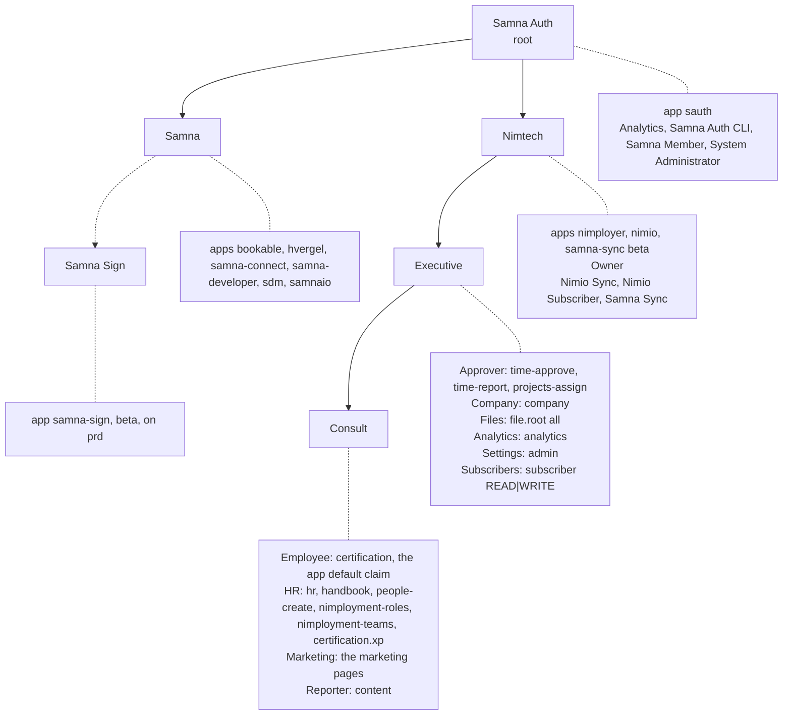

# A worked example

The tree below is the one the tst and prd prophets carry. It shows every part of the model at once: [organizations](./organizations.md) nest for hierarchy, a [claim](./claims.md) owned by an organization binds it with `inherits` and so reaches everything below it, and most claims carry a [scope](./capabilities.md) rather than an object.

## The organizations

| Organization | Under | Owns |
|---|---|---|
| Samna Auth | itself, the root | the `sauth` app and its claims Analytics, Samna Auth CLI, Samna Member, System Administrator |
| Samna | Samna Auth | every Samna app except `sauth`: bookable, hvergel, samna-connect, samna-developer, sdm, samnaio |
| Nimtech | Samna Auth | the solutions nimployer and nimio, the solution Owner claim and the service claims Nimio Sync, Nimio Subscriber, Samna Sync |
| Executive | Nimtech | the claims for administrative capabilities |
| Consult | Executive | the claims every employee or role holder has |

1. Samna Auth is a root: `sa_owner_id = sa_root_id = id`. Samna, Nimtech, Executive and Consult have it as `sa_root_id`, so they are one tenant and one ownership closure.

2. Nimtech is the super admin of its solutions. Its Owner claim binds Nimtech with `inherits`, so it reaches Executive, Consult and every row owned in them.

3. Executive and Consult are ids `...0003` and `...0004` on each prophet, renamed from Consult and Internal. The ids did not change, so no closure row moved; a rename raises no area.

## The claims

| Claim | Owner | Scope it carries |
|---|---|---|
| Approver | Executive | `page`: `time-approve`, `time-report`, `projects-assign` |
| Company | Executive | `page`: `company` |
| Files | Executive | `file.root`: `all` |
| Analytics | Executive | `page`: `analytics` |
| Settings | Executive | `page`: `admin` |
| Subscribers | Executive | `subscriber` at `READ\|WRITE` |
| Employee | Consult | `page`: `certification`; the default claim of the app |
| HR | Consult | `page`: `hr`, `handbook`, `people-create`, `nimployment-roles`, `nimployment-teams`, and `certification.xp` |
| Marketing | Consult | `page`: the marketing pages |
| Reporter | Consult | `page`: `content` |

1. Each claim is one `claim` row owned by its organization, one `claim_object` binding that organization with `inherits`, and one `claim_object` with no object whose `scope` jsonb carries the payload. A person is given a claim by one `user_claim`.

2. The binding with `inherits` is what places a claim in the tree: a claim in Executive reaches every organization and row in Consult below it; a claim in Consult reaches Consult only.

3. There is no one size fits all admin claim. Every capability is its own claim and a person holds the ones they need; an administrator is someone who holds Approver, Company, Files, Analytics, Settings and Subscribers, not someone who holds a claim named admin.

4. A claim name carries no solution prefix, because the claim's `app_id` already says which app it belongs to.

## How a claim reaches a disciple

1. The prophet holds the `organization`, `samna_app`, `claim`, `claim_object` and `user_claim` rows.

2. sasync replicates the claimius rows to every disciple of the app; see [Sync](./sync.md).

3. On the disciple, `sdb.ObjectWhere` reads the object bindings through the stored pairs, and `ScopeAccess` in `shared/access.go`, over `claimius.get_scope_access`, reads the scope grants by jsonpath: `$.page`, `$.file.root`, `$.subscriber`, `$.stats`.

## Changing the tree

1. tst and prd carry the same tree. It is changed only with the `sauth` cli, per config, `sauth --config prd ...`, never with sql or a migration. The former samna_auth seeds `V1.6__initial_nimployer_claims.sql` and `V1.8__initial_analytics_claim.sql` are removed.

2. The beta apps samna-sign and samna-sync belong under Samna but stay where they are: samna-sign under its own Samna Sign organization, rooted at Samna on prd, and samna-sync under Nimtech. The samna_auth api cannot move them: `Organization.ValidatePatch` refuses `owner_id` and `root_id`, and `PutApp` carries no owner field. They move once the api can move an organization or an app, which for an organization across roots is [`migrate_root`](./organizations.md#crossing-roots).
